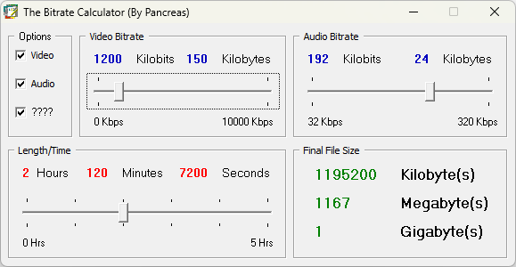
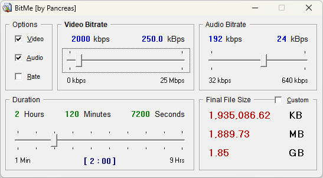

# BitMe (Visual Basic)

This repository holds the source code of the original BitMe written in Visual Basic 4, from 2004 to 2007. It is for my own nostalgic records, but one can take a look and compare it to the [current C++ version](https://github.com/GeoffreyAA/bitme). In October 2026, I fixed the projects without changing the code: some form paths were hard coded; unneeded controls were referenced; and the last version had an issue with the About.frx file. For each milestone, I compiled a native-code executable in Visual Basic 6 SP6, on Windows 11, and made a set of releases, tested on XP and 11. Of course, these are for the sake of interest and archival, and anyone who finds the program useful is advised to use the [present version](https://github.com/GeoffreyAA/bitme/releases).

